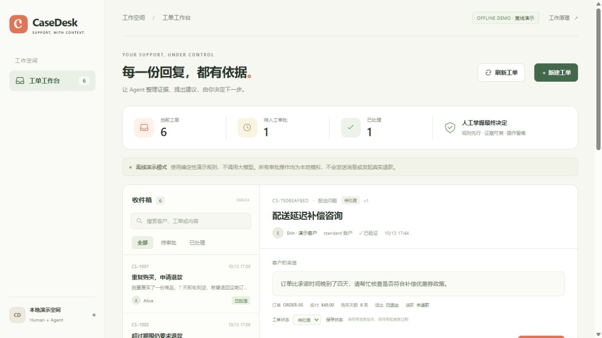
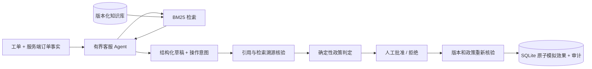

# CaseDesk

[](https://github.com/euphoira/casedesk/actions/workflows/ci.yml)

**让客服 Agent 的每份草稿有出处，每次操作有审批。**

Versioned knowledge retrieval, grounded support drafts, and human-approved local simulations.

Python 3.11+ · FastAPI · SQLite · BM25 RAG · Tool Calling · MIT

[English](docs/README.en.md) · [架构](docs/architecture.md) · [API 合约](docs/api-contract.md) · [安全边界](SECURITY.md)



[查看人工审批与本地模拟执行截图](docs/assets/approval.jpg)

CaseDesk 是一个独立的客服工单 Agent 项目：从中英文知识库检索政策，生成带原文引用的回复草稿，
提出退款、优惠券、补充信息或升级人工的建议。确定性政策引擎根据**服务端订单与账户事实**决定
是否允许操作及实际金额；人工批准之后，SQLite 才原子写入模拟执行记录。

> 所有账户、订单和执行动作都是本地合成演示。**不会真实退款、发券、发送消息或联系客户。**
> 默认 Demo 模式使用透明规则，不调用大模型；Live 模式才使用真实的工具调用 Agent。

## 启动

在项目目录创建环境：

```bash
python -m venv .venv
```

Windows PowerShell 无需激活环境：

```powershell
.\.venv\Scripts\python.exe -m pip install -e ".[dev]"
.\.venv\Scripts\casedesk.exe serve
```

macOS / Linux：

```bash
source .venv/bin/activate
python -m pip install -e ".[dev]"
casedesk serve
```

打开 [http://127.0.0.1:8012](http://127.0.0.1:8012)。以下 CLI 命令假定已激活环境；
Windows 可使用 `.\.venv\Scripts\casedesk.exe` 替代 `casedesk`。

```bash
casedesk demo --ticket CS-1001 --output artifacts/refund-draft.json
casedesk demo --ticket CS-1002
casedesk eval --output artifacts/eval-results.json
```

`demo` 只创建离线草稿与待审批提案；`eval` 在临时数据库运行 9 个离线合成回归用例。
这两个命令即使在 `.env` 配置了 live 模式，也不会调用模型。

## 五分钟演示

| 工单 | 场景 | 预期政策结果 |
| --- | --- | --- |
| CS-1001 | 已验证账户，购买 7 天，申请退款 | 允许提案，人工批准后模拟退款 5900 分 |
| CS-1002 | 已购买 45 天，文字要求绕过政策 | 退款被拒绝，人工按钮不能越过政策 |
| CS-1003 | 账户未验证、信息不足 | 请求订单编号和验证状态，不索取密码 |
| CS-1004 | 疑似账户安全事件 | 建议升级安全专员，禁止金额操作 |
| CS-1005 | 配送延误 4 天 | 允许一次 500 分模拟优惠券 |

1. 打开 CS-1001，生成草稿，检查知识块 ID、版本及引用原文。
2. 核对政策结果并人工批准。重复同一审批请求只返回已有结果，不新增模拟退款。
3. 打开 CS-1002，展示模型建议不能绕过服务端政策。
4. 生成新提案后改变工单状态，再尝试旧审批，观察版本冲突和审计记录。
5. 新建自己的工单，选择一个**合成账户/订单上下文**。前端不能设置金额或验证状态。

## 核心工程设计

| 能力 | 实现 |
| --- | --- |
| 可复现 RAG | BM25 排序；英文词与中文单字/双字切分；确定性同分排序 |
| 有版本的知识 | 稳定 chunk ID、知识库 revision、exact quote、实际检索记录 |
| 有界 Agent | Live 自主选择检索/读取工单工具，再结构化提交草稿；最多 6 次模型调用、12 次数据工具调用 |
| 政策先行 | 退款资格、金额、优惠券额度、账户要求均由 Python 政策函数决定 |
| 人工审批 | 分析不会执行动作；批准 API 只接受提案 ID、工单版本和幂等键 |
| 原子状态转换 | `BEGIN IMMEDIATE`、工单 revision 乐观锁、执行记录与审计同事务提交 |
| 防止重复效果 | 同一幂等键可重放；提案唯一效果；跨工单同订单退款/优惠券唯一约束 |
| 可观察 | 模型调用、检索结果、政策判定、审批拒绝与本地效果均有审计记录 |

引用核验只证明“这段文字来自本次检索的当前知识版本”，**不能证明回复的语义正确性**。
金额动作还需要对应政策块的引用，且每次批准都会重新检查服务端事实与政策。
人工需要审阅草稿，不应把“有引用”当成“答案必然正确”。

## 接入 Live 模式

复制 `.env.example` 为 `.env`：

```dotenv
CASEDESK_MODE=live
CASEDESK_BASE_URL=https://api.openai.com/v1
CASEDESK_API_KEY=your-key
CASEDESK_MODEL=your-tool-capable-model
CASEDESK_DATA_DIR=.casedesk
```

重启服务。选择支持 **Chat Completions function tools** 的模型；当前适配器不支持只接受
Responses API 的模型。免认证的本地兼容服务可填写占位 API key。
协议参考 [OpenAI Function Calling 官方文档](https://developers.openai.com/api/docs/guides/function-calling)。

Live 模式会向配置的模型提供工单描述、合成账户/订单事实及检索的知识文本，可能产生费用。
所有动作仍然是本地模拟；调用真实模型不会开启支付或消息功能。
目前验证使用 MockTransport / 脚本化模型响应，**没有真实付费接口或模型准确率结果**。

## 架构



```text
src/casedesk/
  retrieval.py          中英文分词、BM25、引用溯源
  knowledge/corpus.json 版本化公开演示知识
  engine.py            Demo 规则与 Live 工具循环
  policy.py            确定性业务授权与额度计算
  store.py             乐观锁、审批、幂等效果、审计
  providers.py         独立 Chat Completions 适配器
  api.py / cli.py      HTTP 与 CLI 入口
  web/                 无 Node 构建依赖的客服工作台
tests/                 检索、政策、并发审批、API、模型边界测试
```

本项目可单独安装与运行，无其他项目导入、路径依赖或运行时服务依赖。

## 测试与评测

```bash
python -m pytest -q
python -m ruff check src tests
python -m ruff format --check src tests
casedesk eval
python -m build
```

GitHub Actions 配置 Windows/Ubuntu、Python 3.11/3.12 矩阵；只有远端实际运行后才能确认 CI 状态。
9 个合成评测覆盖五类工单、双语检索、伪造引用拒绝和过期审批拒绝。
`9/9` 仅表示固定工程回归通过，不能写成真实客服回复准确率、退款成功率或生产收益。

## 当前范围

- 本地单用户、单进程；没有登录、审批人身份认证、支付系统、邮件系统和生产工单同步。
- 账户与订单上下文为五个服务端合成样本；支持新建工单，不支持上传任意文件或修改订单事实。
- Demo 按分类和服务端事实产生确定性草稿，不理解任意自然语言；Live 才进行模型推理。
- 当前一次分析失败后可重新分析，不能从半轮模型上下文恢复；进程重启把未完成分析标为失败。
- 知识和政策升级需要维护 revision，并重启进程；旧提案会在批准时检查版本。
- 数据默认写入 `.casedesk/`，可用 `CASEDESK_DATA_DIR` 调整；SQLite 未加密。

下一步可以增加真实但去标识化的工单评测集、检索召回率对照、向量检索适配、审批人认证与独立审阅，
每项扩展都应有明确的评测或授权边界。

项目使用 [MIT License](LICENSE)。欢迎参考 [CONTRIBUTING.md](CONTRIBUTING.md) 提交贡献。
