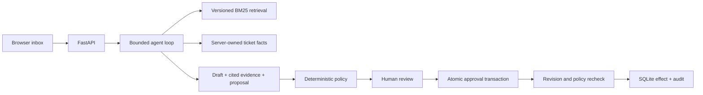

# CaseDesk

[简体中文](../README.md) · [HTTP API](api-contract.md)

A local customer-support inbox that connects versioned knowledge retrieval, grounded reply drafts, deterministic business policy, and human-approved simulated actions.


[View human approval and local simulation](assets/approval.jpg)

CaseDesk separates a model's proposed action from authorization. A draft can suggest a refund; the server checks eligibility and computes the amount from its own order data. A person must approve the proposal before an atomic transaction records the simulated effect.

**All actions are local simulations. CaseDesk does not send customer messages, issue real refunds, or connect to payment systems.** The default demo uses deterministic fixtures and makes no model calls.

## Run locally

Requires Python 3.11 or newer. From the repository root:

```bash
python -m venv .venv
```

Activate the environment:

```powershell
# Windows PowerShell
.\.venv\Scripts\Activate.ps1
```

```bash
# macOS / Linux
source .venv/bin/activate
```

Install and start:

```bash
python -m pip install -e ".[dev]"
casedesk serve
```

Open [the local inbox](http://127.0.0.1:8012). No API key or frontend build is required for demo mode. The interface is in Chinese and uses locally bundled HTML, CSS, and JavaScript.

## A five-minute walkthrough

1. Open `CS-1001` and generate a handling suggestion. Inspect the retrieved policy, verified citations, deterministic verdict, and unsent customer reply.
2. Approve its simulated refund. The app records the effect and advances the ticket revision. Check the audit tab for the policy recheck and local operation.
3. Open `CS-1002`. Its 45-day purchase is outside the refund window, so business policy blocks the action despite the customer's request to ignore the policy.
4. Generate a suggestion for `CS-1003` or `CS-1004`. Review the request for verification or the proposed security escalation.
5. For a pending proposal, change the ticket status before approving it. The old proposal becomes stale; generate a new analysis to continue.
6. Open `CS-1005` to review a delivery-delay coupon suggestion, or create your own ticket using one of five synthetic account/order contexts. The server supplies order amounts and account verification facts; customer text cannot overwrite them.

The inbox also supports ticket filtering, additional knowledge searches, proposal rejection, and inspection of audit payloads. Search results are shown separately and do not silently modify an existing proposal.

## Optional live model

The CLI reads a local `.env` file. Configure an OpenAI-compatible Chat Completions endpoint that supports function calls:

```dotenv
CASEDESK_MODE=live
CASEDESK_MODEL=your-tool-calling-model
CASEDESK_API_KEY=your-api-key
CASEDESK_BASE_URL=https://api.openai.com/v1
```

Restart `casedesk serve` after changing configuration. Live mode sends ticket content and retrieved policy text to the configured model provider. The browser displays whether it is using offline fixtures or a live model. Actions remain local simulations in both modes.

Keep credentials out of Git. `CASEDESK_DATA_DIR` optionally overrides the default `.casedesk` directory, which contains the local SQLite database. The service binds to `127.0.0.1` and is designed for a single local user.

## Architecture



- **Retrieval:** versioned policy chunks ranked with BM25. Citations must reference retrieved chunks with matching revisions and exact quoted substrings.
- **Agent tools:** `search_knowledge`, `get_ticket`, and `propose_resolution`. The agent has no direct execution tool. The default live budget is six model turns and twelve investigation tool calls.
- **Authorization:** server-side rules decide refund eligibility and monetary amounts from trusted order facts. Model-generated text does not grant authorization.
- **Approval:** ticket, policy, corpus, and analysis ownership checks reject stale proposals. Idempotency keys protect approval retries, and effects are recorded atomically in SQLite.
- **Observability:** analysis, policy, approval, and simulated effects are inspectable through the audit log. Failed analysis produces no new approvable proposal.
- **UI:** dependency-free, responsive vanilla JavaScript with escaped dynamic content and explicit pending, rejected, blocked, and stale states.

See [the HTTP contract](api-contract.md) for request and response shapes.

## Verification

```bash
python -m pytest
python -m ruff check .
casedesk eval --output artifacts/eval-results.json
casedesk demo --ticket CS-1001 --output artifacts/demo-analysis.json
```

`casedesk demo` always runs offline and only creates a draft. `casedesk eval` uses a temporary database to run nine synthetic regression cases covering expected proposal/policy behavior, retrieval, fabricated citations, and stale approval rejection. These are regression checks, not a measurement of live-model accuracy or production business outcomes.

## Scope

This project demonstrates a reviewable Agent application with a real local workflow. It is not a hosted support service: it has no multi-user authentication, tenant isolation, production payment integration, or external message delivery. Its synthetic knowledge and order fixtures make behavior easy to reproduce without private customer data.

Licensed under [MIT](../LICENSE).
