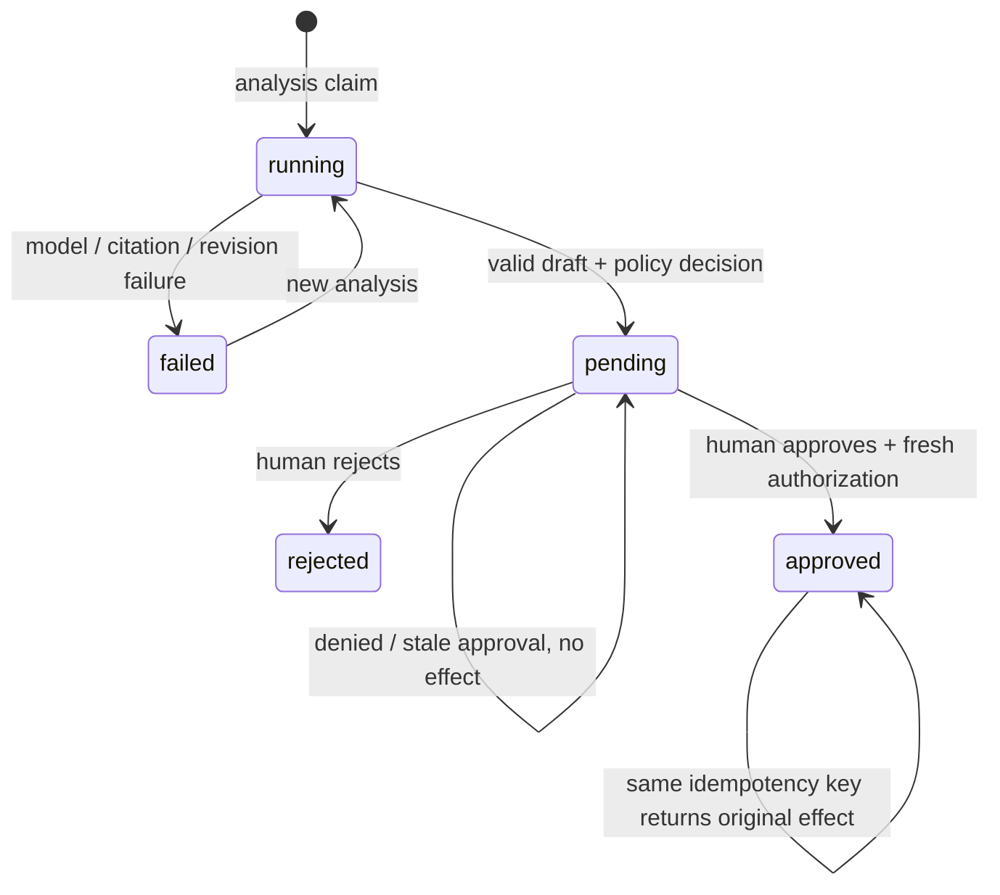

# Architecture and invariants

CaseDesk is a standalone, local support triage application. Its useful unit is an
**approval-gated action proposal**, not an autonomous side effect. No external payment,
message delivery, account modification or repository execution capability exists.

## Grounded drafting

The packaged corpus carries a global revision and stable chunk IDs. Search tokenizes English
words/numbers and Chinese characters/bigrams, then ranks chunks with BM25 (k1=1.5, b=0.75).
Equal scores sort by chunk ID. Queries are at most 500 characters and return at most five chunks.
This is lexical retrieval, with no embedding service or vector database requirement.

Live mode exposes `search_knowledge`, `get_ticket`, and `propose_resolution`. The model chooses
searches, observes results and submits an action intent with a draft. Six logical model calls,
twelve data-tool calls, four calls per response and provider byte/time limits bound execution.
`propose_resolution` must be the only call in its response. Unknown tools only return a safe error.
The model has no approval, payment, messaging, filesystem or network tool.

Each citation must match a current chunk ID/revision, contain an exact quote, and reference a
chunk actually retrieved during that analysis. Stored retrieved text must equal the current
corpus text. Refund/coupon eligibility additionally requires the corresponding policy chunk.
These checks prove source provenance, **not that an unrestricted draft is semantically true**.

Demo mode uses fixed category/account rules to demonstrate the same retrieval, citation,
policy and approval paths. It is explicitly labeled and never calls a language model.

## Business authorization

Ticket intake accepts subject, body, category and a synthetic server-owned context ID.
It never accepts amounts, verified flags, purchase dates or arbitrary account identifiers.
The ticket category is human-supplied triage metadata; the system does not guarantee detection
of security intent hidden in arbitrary text. Account-category tickets cannot receive monetary
actions. The account facts, amounts and order state come from server-owned demo contexts.

The policy engine independently checks account verification, purchase age, delivery status,
previous effects and limits. Refund values come from the stored order; coupons are fixed at
500 cents after at least three days' delay. Model-generated amounts are not part of the
resolution schema, and effect parameters are recalculated when approving.

Request-info proposals only request order ID and verification status. Escalations select a
fixed queue. Both also require human approval before writing a local simulated effect.

## State transitions

The diagram combines analysis and proposal stages; JSON has separate status fields.
A denied policy can still produce a visible pending proposal for review, but approval will
re-evaluate and refuse it. A newer analysis invalidates earlier proposals even when ticket
revision has not changed. A ticket status edit or applied effect increments ticket revision.

An approval runs under `BEGIN IMMEDIATE` and verifies:

1. The idempotency key is new, or matches this exact proposal and ticket version.
2. The proposal is pending and belongs to the latest analysis.
3. Submitted, proposal and current ticket revisions all match.
4. Policy and corpus revisions are unchanged, and citations still verify.
5. Current server-owned order/account facts and prior effects permit the action.

Only then does one transaction insert the simulated effect, reserve the idempotency key,
update proposal/ticket state, and append the policy/action audit events. A successful retry
returns the original effect even though the ticket revision advanced. A reused key with a
different proposal/version fails. SQLite uniqueness protects proposal effects and monetary
actions per order across distinct tickets.

This is exactly-once **local simulated state**, not a claim about external payment systems.
An external integration would need outbox delivery, reconciliation and provider idempotency.
Denied approvals also append an audit record while leaving business state unchanged.

## Failure and durability

Analyses reserve model-call count before outbound I/O. Retries may incur additional provider
cost; logical call counts are not a billing ledger. Connections, whole attempts and response
bytes are bounded. Transport failures, 429 and 5xx retry at most twice; validation/auth failures
do not retry. Provider errors omit remote bodies and credentials; redirects are disabled.

Interrupted analyses become failed on startup. Users may start a new analysis; no claim is
made about resuming incomplete model conversations. Once an approval transaction commits,
the effect, idempotency receipt, revision and audit survive process restart together.

SQLite is configured with WAL and per-operation connections. Use exactly one server process;
startup recovery and per-process model concurrency limits are not a distributed worker lease.

## Operational limits

| Boundary | Value |
| --- | --- |
| API request body | 16,000 bytes, including chunked bodies |
| New ticket subject/body | 160 / 4,000 characters |
| Local tickets | 200 |
| Concurrent analyses | 2 |
| Logical model calls / data tools | 6 / 12 per analysis |
| Provider request/response bytes | 220,000 / 500,000 |
| Provider attempt timeout/retries | 30 seconds / at most 2 retries |
| Search query / returned chunks | 500 characters / 5 |
| Citation count | 6 |

The server binds loopback, checks hosts and write origins, restricts body size and serves static
assets under a Content Security Policy. This is defense in depth, not authentication.
See [security](../SECURITY.md), [HTTP contract](api-contract.md), and the tests for exact behavior.
